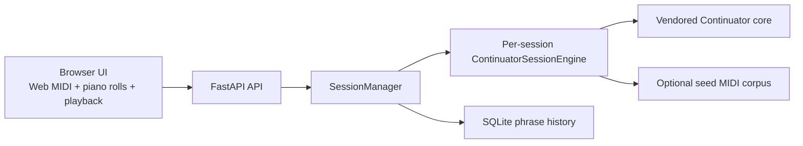

# Web Continuator

This repository packages Continuator as a browser-based instrument and API wrapper.
It lets a user play a MIDI phrase in the browser, send that phrase to a Python Continuator engine, receive a generated continuation, and play it back immediately.

The current implementation is meant as an MVP for experimentation, demos, and architecture validation. It already supports:

- Browser-side real-time MIDI capture with the Web MIDI API.
- A touch-oriented virtual keyboard that works without Web MIDI hardware.
- A `FastAPI` backend that wraps the Python Continuator engine.
- One isolated Continuator engine per live session.
- SQLite logging for captured and generated phrases.
- Session MIDI export for all played/generated phrase pairs.
- A compact UI with MIDI controls, phrase playback, and session activity views.
- A tabbed `History | Memory` activity card.
- Docker packaging suitable for local containers and Hugging Face Docker Spaces.

## Goals

This project is trying to validate a web architecture for Continuator with a clear separation of responsibilities:

- The browser owns the real-time MIDI interaction.
- The Python backend owns phrase learning and generation.
- Session state is isolated so multiple users do not share musical memory by accident.
- Phrase history is stored separately from the live model state.

This is important because the original Continuator codebase is centered on local Python usage, while this project explores a true client-server version with a JavaScript front-end.

## Current Scope

What is implemented today:

- Session creation and reset.
- Web MIDI input selection in the browser.
- Browser sampled piano/violin playback, browser synth playback, or hardware MIDI output playback.
- Optional MIDI fan-out to one additional hardware or virtual MIDI output.
- Optional live MIDI input monitoring through the selected playback renderer.
- Phrase capture based on silence detection.
- Continuator settings exposed through a compact advanced drawer.
- Per-session `History` and `Memory` visualization.
- `Save Session MIDI` export from the Session panel.
- Accounts, saved-session reopening, and saving an existing guest session to an account.
- Optional private Hugging Face Bucket backups of accounts, phrase history, and exact session memory.

What is intentionally not implemented yet:

- Persistent per-user musical memory across sessions.
- Shared session storage across multiple backend instances.
- A production-grade multi-user database architecture.

## Product And UX Overview

The UI is organized around a simple performance loop:

- `Session`: create a new isolated Continuator session or reset its memory.
- `Save Session MIDI`: export every played/generated phrase pair from the current session as MIDI files in one ZIP archive.
- `MIDI I/O`: connect browser MIDI, choose an input port and playback renderer, and optionally copy playback to another MIDI output.
- `Phrase Flow`: monitor captured and generated note counts, send a phrase manually, replay the last continuation, or clear local buffers.
- `Session Activity`: switch between `History` and `Memory`.

The UX principle is to keep the performance flow visible at all times and hide lower-frequency controls behind progressive disclosure:

- High-frequency controls stay on the main surface.
- Advanced model controls live in the `Advanced Continuator Settings` drawer.
- Memory inspection stays inside a local tabbed card rather than taking over the page.

### Phone Layout

Phones use the same application and backend as desktop browsers. A compact,
touch-oriented layout is selected from viewport and pointer capabilities rather
than device names. Detection combines the current viewport, mobile browser
client hints, phone browser identification, touch-pointer capability, and
physical CSS screen dimensions so Android phones still select the phone surface
when the browser reports a desktop-sized viewport. The layout class is applied
before styles load to avoid briefly showing the full desktop controls. The phone
surface contains the virtual keyboard, a small live-status message, the
captured/generated piano rolls, and an account/save-status bar. The account dialog
supports sign-in and reopening saved sessions on both phone and desktop.
Configuration, memory inspection, hardware MIDI, and device routing remain
available in the desktop/tablet layout.

Phone interaction is deliberately automatic:

1. Open the app in Safari on iPhone or Chrome on Android.
2. The app creates a guest session and selects the virtual keyboard.
3. Play a phrase, then release all notes.
4. After the phrase gap, the phrase is submitted automatically and the
   Continuator response plays through the browser instrument.
5. Tap either piano roll to replay the captured phrase or generated response.
6. Use `Oct -` and `Oct +` to move the one-octave keyboard range.

Phone mode is intended for playing and listening. Use the desktop/tablet layout
when you need session management, model settings, memory inspection, MIDI
hardware, or sound routing.

For troubleshooting, append `?layout=phone` to force the phone surface or
`?layout=desktop` to force the complete interface.

## Saving Session MIDI

The Session panel includes `Save Session MIDI`.

When clicked, the browser asks the backend for a ZIP archive containing one `.mid`
file for each played input phrase and each generated phrase in the current
session. Filenames preserve the phrase order and label files as `input` or
`generated`.

In browsers that support the File System Access API, such as Chrome and Edge,
the button opens a file-save picker for the ZIP archive. The checkbox labelled
`Don't ask again` remembers the selected ZIP file handle in browser storage and
overwrites that same ZIP on future saves after permission is granted. This
intentionally remembers a file, not a folder, because Chrome can reject folder
access for protected locations.

If the browser does not support the file-save picker, the export falls back to a
normal browser download. Hugging Face embeds Spaces in a cross-origin frame, so
the embedded Space also uses the normal browser download flow; open the direct
Space URL if you want Chrome's file-save picker and `Don't ask again` behavior.
The backend also keeps `POST /api/sessions/{session_id}/save-midi` as a
server-side fallback route, but browser users should prefer the ZIP download
path because it writes to a location they choose locally.

## High-Level Architecture



At a high level:

- The browser captures raw MIDI events in real time.
- The browser segments those events into phrases.
- The backend converts phrase JSON into `mido.Message` objects.
- The session-specific engine learns the phrase and samples a continuation.
- The backend converts the result back to JSON.
- The browser renders and plays the continuation.

## Runtime Pipeline

The phrase pipeline is:

1. A desktop user connects and chooses a MIDI input, or a phone user plays the
   automatically selected virtual keyboard.
2. The browser receives `note_on` and `note_off` events in real time.
3. The front-end keeps a phrase open while notes are still active.
4. A phrase closes when all notes are released and the selected phrase gap has passed since the final note event. The UI defaults this gap to 1 second after the final `note_off`.
5. The browser stores the captured phrase as JSON with timing deltas.
6. The client sends that JSON to `POST /api/continue`.
7. The backend reconstructs `mido.Message` objects and asks Continuator for a phrase representation.
8. The backend follows the current Continuator strategy: learn the input phrase first, then generate.
9. The backend returns both the input phrase and generated phrase as note-level and event-level JSON payloads.
10. The browser updates the piano rolls, logs the interaction, plays the continuation, and refreshes visible session views without blocking the performance flow.

By default, the backend asks for a continuation with the same note count as the input phrase.

For robustness, the wrapper currently retries generation without the hard end constraint if the exact same-length plus exact-ending request has no solution. This helps some dense or chordal phrases without modifying the Continuator core itself.

### Front-End Performance Behavior

Long or dense phrases are handled without rebuilding the complete display for
every MIDI event:

- Live capture updates event and completed-note counters incrementally.
- The captured piano roll uses the same incremental note cache for a throttled
  live preview, then renders the final phrase when it closes. It does not copy
  or reconstruct the full event history after every `note_on` or `note_off`.
- Dense piano rolls use a reduced-effect drawing path that avoids an expensive
  blurred shadow for every individual note.
- Repeated MIDI status text is written only when it changes. Phrase-gap and
  server-wait indicators update at a modest rate so the controls pane is not
  continuously repainted during capture or generation.
- Phrase playback keeps the piano-roll canvas stable and animates a lightweight
  playhead overlay for both captured and generated phrases.
- `History`, `Memory`, and saved-session payloads refresh only when their
  corresponding view is visible. Opening a view refreshes it on demand.

These rules keep browser interaction responsive while capturing or playing
phrases containing many notes. Server-side learning and generation time is
reported separately in the timing readout.

## Session Model

A session is the main runtime boundary in this application.

Each session contains:

- One in-memory Continuator engine.
- One current settings snapshot.
- Logged phrase history in SQLite.
- A live memory view derived from the engine state.

All sessions use Continuator 2.0's VO Regular BP engine through its public
`Continuator2` facade. The engine selector and retired decay controls have been
removed. Legacy saved metadata containing `engine_kind` or `decay_mode` is
accepted and ignored when opening or listing sessions; restored sessions use
VO Regular BP.

Changing model/memory controls in the browser stages them until `Apply Settings`
is pressed. Changing Markov order `K` rebuilds the live engine while preserving
its existing note sequences, including transposed variants, without applying
transposition or rolling-memory limits a second time. Rolling-memory limits
continue to apply to newly learned input.

Important distinction:

- `History` is everything that was logged for the session.
- `Memory` is only what is currently active inside the Continuator engine.

Those are not always the same:

- If `forget old phrases` is enabled, some historical phrases may no longer be active in memory.
- If `transpose` is enabled, one learned phrase can appear as several active memory sequences.
- If the backend is restarted, the engine restores its exact committed memory variants from SQLite.

## Memory Model

The `Memory` tab is a visualization of the active engine state for the current session.

It shows:

- Summary chips with the active sequence count and settings.
- A recency ribbon from oldest to newest.
- A list of active memory slots, newest first.

The memory view is based on the Continuator engine's current `input_sequences`.
Each variant has a stable `memory_id` and a source `phrase_id`. Transposed
variants share their source ID but can be deleted individually. Delete requests
include the variant ID, so an outdated view cannot delete a different phrase
that moved into the same slot.

SQLite stores exact notes (including overlap and handoff timing) for each active
variant. Restoration does not transpose, prune, or re-import the seed corpus.
Seed flags follow the variants that remain after rolling-memory eviction.

If a seed MIDI file or folder is loaded, memory items are labeled as:

- `seed`: sequences learned from the seed corpus at session initialization.
- `live`: sequences learned from browser interaction during the session.

Current limitation:

- This is session memory, not yet user memory.
- There is no persistent musical profile that follows a user across sessions.

## Continuator Settings Exposed In The UI

The advanced drawer currently exposes existing Continuator parameters already present in the original Gradio interface:

- `Learn input`
- `Markov order K`
- `Transpose`
- `Forget old phrases`
- `Keep only N last inputs`

Design choice:

- `Learn input` stays visible because it directly affects performance behavior.
- The other parameters live in the advanced drawer because they are lower-frequency controls.

## Repository Layout

```text
backend/
  app/
    config.py
    continuator_adapter.py
    graph_renderer.py
    main.py
    memory.py
    midi_export.py
    phrase_formatting.py
    schemas.py
    session_manager.py
    session_operations.py
    storage.py
  tests/
  data/
frontend/
  app.js
  app-state.js
  constants.js
  midi-capture.js
  midi-input.js
  piano-roll.js
  playback-controller.js
  playback-renderers.js
  session-controller.js
  views.js
  tests/
  index.html
  styles.css
Dockerfile
README.md
```

Main responsibilities:

- `frontend/index.html`: page structure and UI regions.
- `frontend/app.js`: composition root, event bindings, preferences, and application startup.
- `frontend/app-state.js` and `constants.js`: DOM bindings, shared state, and static configuration.
- `frontend/midi-capture.js` and `midi-input.js`: phrase segmentation, hardware/virtual MIDI input, and monitoring.
- `frontend/playback-renderers.js` and `playback-controller.js`: audio/Faust instruments, MIDI output, playback, and infinite-mode scheduling.
- `frontend/session-controller.js`: API requests, authentication, session lifecycle, imports, and generation requests.
- `frontend/views.js` and `piano-roll.js`: status/settings/memory/history views and canvas rendering.
- Controllers receive dependencies explicitly from `app.js`; they never import the composition root. Standalone capture, renderer, and API logic can be tested without a browser.
- `frontend/styles.css`: layout and visual design.
- `backend/app/main.py`: FastAPI routes.
- `backend/app/midi_export.py`: phrase-payload to MIDI conversion and ZIP packaging.
- `backend/app/session_manager.py`: session lifecycle, orchestration, and API-facing session logic.
- `backend/app/continuator_adapter.py`: bridge between web JSON payloads and the Continuator Python engine.
- `backend/app/storage.py`: transactional SQLite history, reset revisions, learning order, and exact variant persistence.
- `backend/app/cloud_backup.py`: consistent snapshots, private bucket uploads, retention, and validated startup recovery.
- `frontend/backup-status.js`: cloud durability feedback that accounts for pending browser writes.
- `backend/app/memory.py`: stable variant identity and lossless note snapshots.
- `backend/app/session_operations.py`: per-session operation locking and rollback recovery.
- `backend/app/graph_renderer.py`: pure SVG layout from detached snapshots and traces. Layout runs outside the session/engine locks.
- `continuator`: installed Python package providing the Continuator engine.

## API Surface

Current API endpoints:

- `GET /health`: lightweight health check.
- `GET /api/config`: public app-level configuration.
- `POST /api/session`: create a new session and its isolated Continuator engine.
- `PATCH /api/sessions/{session_id}/settings`: update live session settings.
- `POST /api/continue`: send one phrase and request a continuation.
- `POST /api/sessions/{session_id}/generate`: generate a phrase directly from memory.
- `GET /api/sessions/{session_id}/history`: retrieve recent logged phrase history.
- `GET /api/sessions/{session_id}/memory`: retrieve the active memory snapshot for the live engine.
- `DELETE /api/sessions/{session_id}/memory/{slot}?memory_id={id}`: delete one live variant, checking its stable identity before changing memory.
- `GET /api/sessions/{session_id}/graphs/memory.svg`: render a detached memory snapshot.
- `GET /api/sessions/{session_id}/graphs/constraints.svg`: render the latest generation trace and constraint status.
- `GET /api/sessions/{session_id}/midi-download`: return played and generated phrases as base64 MIDI file payloads.
- `GET /api/sessions/{session_id}/midi.zip`: download played and generated phrases as a ZIP archive for the browser save/download flow.
- `POST /api/sessions/{session_id}/save-midi`: save played and generated phrases as MIDI files on the backend as a server-side fallback.
- `POST /api/sessions/{session_id}/reset`: clear the live engine memory while preserving session settings.

API payloads use JSON and expose both:

- event-level timing data for playback
- note-level timing data for visualization
- constraint status and native per-step `generation_trace` diagnostics from VO Regular BP

`Generate From Memory` requests both beginning and ending constraints by default
and reports when either constraint has to be relaxed. `Send Phrase` conditions
generation on the played phrase as a prefix; the variable-order model uses up
to K preceding viewpoints and can back off to a shorter context. The prefix
is not replayed in the output. If the requested ending is infeasible, the
backend retries with the same prefix and no hard end constraint before trying
unprompted generation. Only when the prefix cannot produce the requested note
count does it fall back to a fresh phrase from memory, with an explicit status
message and a relaxed start indicator.

Infinite-mode chaining uses
the continuation endpoint with the previous phrase as context; its memory
re-seed fallback disables the beginning constraint. A preserved handoff viewpoint
restores the final note's overlap state while retaining earlier prefix context.

## Local Development

Use Python 3.11 or newer. Frontend development checks use Node.js 24 (or an
ESLint-supported Node.js release: 20.19+, 22.13+, or 24+). The deployed app
serves native JavaScript modules and does not require Node.js or an npm build.

Create a virtual environment, install dependencies, and launch the backend:

```bash
python3 -m venv .venv
source .venv/bin/activate
pip install -r backend/requirements.txt
python -m uvicorn app.main:app --app-dir backend --reload
```

Run integration checks against the pinned Continuator dependency:

```bash
pip install -r backend/requirements-dev.txt
PYTHONPATH=backend python -m pytest backend/tests -q
python -m ruff check backend/app backend/tests --select F,E9
npm ci
npm run check
npm test
```

Open:

```text
http://127.0.0.1:8000
```

Recommended browser support:

- Chrome
- Edge
- Safari on iPhone
- Chrome on Android

`localhost` is a valid secure context for Web MIDI, so HTTPS is not required for local development.

Typical desktop interaction:

1. Click `Create Session`.
2. Click `Connect MIDI`.
3. Choose a MIDI input.
4. Choose `Browser Synth` or a hardware output.
5. Optionally choose another hardware or virtual port under `Also send MIDI to`.
6. Optionally open `Model and Memory Settings`.
7. Play a phrase.
8. Wait until the selected phrase gap has elapsed after the final note release. The default gap is 1 second.
9. Let auto-send submit the phrase, or click `Send Phrase`.
10. Inspect `History` or `Memory` in the `Session Activity` card.
11. Use `Save Session MIDI` in the Session panel to export the played/generated phrases as a ZIP archive of MIDI files.

Typical phone interaction:

1. Open the local-network URL on a phone connected to the same network.
2. Play the virtual keyboard; no MIDI connection step is required.
3. Release the notes and wait for auto-send to generate the response.
4. Tap the captured or generated piano roll to replay it.

When you change frontend code, a normal refresh is usually enough.
When you change backend models or routes, restarting the server and refreshing the page is the safest option.

## Configuration

Environment variables currently supported:

- `CONTINUATOR_APP_NAME`: override the displayed app name.
- `CONTINUATOR_DB_PATH`: move the SQLite database to another location.
- `CONTINUATOR_SESSION_EXPORT_DIR`: choose where fallback backend-side MIDI exports are written.
- `CONTINUATOR_SEED_MIDI_FILE`: preload each new session with one MIDI file.
- `CONTINUATOR_SEED_MIDI_FOLDER`: preload each new session with a folder of MIDI files.
- `CONTINUATOR_BACKUP_BUCKET`: optional private bucket ID, for example `pachet/continuator_front-storage`.
- `CONTINUATOR_BACKUP_TOKEN`: backend-only secret with read/write access to that bucket. Falls back to the standard Hub `HF_TOKEN` or cached login for local development.
- `CONTINUATOR_BACKUP_INTERVAL_SECONDS`: background backup interval, default `5`, minimum `1` second.

Examples:

```bash
export CONTINUATOR_SEED_MIDI_FILE=/absolute/path/to/example.mid
export CONTINUATOR_DB_PATH=/absolute/path/to/continuator.sqlite3
export CONTINUATOR_SESSION_EXPORT_DIR=/absolute/path/to/session-midi-exports
```

## Optional Seed Corpus

If you want each new session to start from an existing corpus instead of an empty Continuator memory, set one of the seed variables before launching the server:

```bash
export CONTINUATOR_SEED_MIDI_FILE=/absolute/path/to/example.mid
export CONTINUATOR_SEED_MIDI_FOLDER=/absolute/path/to/midi/folder
```

This changes the starting memory of each newly created session, but sessions remain isolated from one another.

## Docker

Build and run locally:

```bash
docker build -t continuator-web .
docker run --rm -p 7860:7860 continuator-web
```

Why the Docker image is simple:

- The frontend is static and does not require a separate Node build.
- The backend serves both the API and static assets.
- The image exposes port `7860`, which matches common Hugging Face Docker Space conventions.

## Deploying To Hugging Face Spaces

This repository is now prepared to be used as a Docker Space.

The YAML block at the top of this `README.md` declares:

- `sdk: docker`
- `app_port: 7860`

Typical deployment flow:

1. Create a new Space on Hugging Face.
2. Choose the `Docker` SDK.
3. Push this repository to the Space repository.
4. Let the Space build automatically from the included `Dockerfile`.

Existing SQLite databases upgrade automatically on startup. The migration adds
learning sequences, reset revisions, and exact memory variants while preserving
history. The first opening of a legacy session creates its variant snapshot.
No manual SQL migration or memory reset is required. Configure cloud backups or
use a persistent filesystem when saved sessions must survive a Space rebuild.

After a deploy, refresh the browser. HTML, JavaScript modules, and stylesheets
revalidate against the server so the split frontend loads the current release.

### Signing in inside the Hugging Face page

The embedded app uses a separate, secure, HTTP-only partitioned cookie so sign-in
can persist when ordinary third-party cookies are blocked. Direct app visits use
the existing first-party cookie. These views have separate browser sign-ins but
share the same Continuator accounts and saved sessions. Embedded authentication
requires the `X-Continuator-Embedded` request header; ordinary cross-site forms
cannot supply it, and the API does not enable cross-origin requests.

After login or registration, the frontend confirms the cookie with `/api/auth/me`
before attaching the guest session. If the browser still rejects it, the guest
session stays open and the dialog offers **Open the app in its own tab**. These
are Continuator accounts; Hugging Face account credentials are separate.

### Private cloud backups on free hardware

1. Create a **private** [Hugging Face Storage Bucket](https://huggingface.co/docs/hub/storage-buckets).
2. In the Space settings, add the variable `CONTINUATOR_BACKUP_BUCKET` with the bucket ID.
3. Add `CONTINUATOR_BACKUP_TOKEN` as a **secret**, using a token with read/write access to the bucket. A dedicated token scoped to this bucket is preferable.
4. Deploy and wait for **Cloud saved** in the bar above the workspace.

The deployed `pachet/continuator_front` Space uses the private bucket
`pachet/continuator_front-storage`. Its bucket-scoped credential is stored only
in the Space's `CONTINUATOR_BACKUP_TOKEN` secret. The bucket is also attached at
`/data`, but the live SQLite database stays on the container's local disk;
snapshots are uploaded and restored through the Hub API. Do not move the live
SQLite database onto the object-storage mount.

The live SQLite database stays on the local filesystem. SQLite's backup API
captures committed WAL changes consistently, then a single background worker
uploads an immutable snapshot and publishes `continuator-backups/latest.json`
only after the snapshot succeeds. The latest three snapshots are retained.
Uploads retry automatically; generation requests do not wait for the network.
The UI distinguishes **Saving to cloud**, **Cloud saved**, **Cloud save failed**,
and **Local storage only**. A snapshot is reported saved only while it covers
all committed writes, including account and ownership changes.

On startup, the app downloads and checks the latest snapshot's checksum, SQLite
integrity, references, and database identity before opening it. Recovery errors
stop startup rather than allowing an empty database to overwrite a good cloud
backup. A newer local copy is preserved; conflicting local/cloud databases
require manual recovery. Older retained snapshots can be downloaded by the
bucket owner for manual recovery if needed.

**Limits:** changes after the last successful backup can still be lost on an
abrupt reset. Wait for **Cloud saved** before leaving important work, and keep
personal MIDI ZIP exports as an extra copy. Backups include password hashes and
authentication tokens as well as music; keep the bucket private and the token
out of frontend code and Git. One application process must own this bucket
prefix; this is not replication or a multi-server database. Backend MIDI export
folders are not included because the phrase data can regenerate those files.

**First deployment:** enabling this feature cannot rescue an already erased
database. Export important phrases before replacing an older, unprotected Space.
Subsequent restarts recover from the most recent successful cloud backup.

An actual persistent filesystem can alternatively hold the live database:

```bash
CONTINUATOR_DB_PATH=/data/continuator.sqlite3
```

The browser ZIP export does not require persistent Space storage because the
archive is downloaded to the user. In the embedded Hugging Face Space page,
browser security rules block Chrome's file-save picker, so exports fall back to
the browser's normal download flow. The server-side fallback `save-midi` route
writes inside the container unless `CONTINUATOR_SESSION_EXPORT_DIR` points to a
mounted volume, so it is mainly useful for local development or managed storage
setups.

If you want each new session to start from a corpus, you can also define:

```bash
CONTINUATOR_SEED_MIDI_FILE=/data/seeds/example.mid
CONTINUATOR_SEED_MIDI_FOLDER=/data/seeds
```

For a public demo that preserves saved sessions:

- free CPU hardware
- private bucket backups, without a paid persistent disk
- no seed corpus
- browser-side MIDI ZIP exports for personal copies

That keeps the setup minimal and is enough to validate browser MIDI capture, API round-trips, and continuation playback.

## Hugging Face Spaces Notes

This repository is shaped for a Docker Space:

- one container
- static frontend
- Python API
- no extra frontend build pipeline

That makes it a good fit for a public demo or lightweight prototype.

Things to keep in mind:

- The current live session registry is in process memory, so scaling to multiple replicas would require shared session storage.
- SQLite is fine for a prototype, but PostgreSQL would be a better next step for heavier concurrent use.
- Persistent user memory is not implemented yet.
- Browser MIDI ZIP exports are user downloads; backend-side MIDI export folders need mounted storage if they should survive a Space rebuild.
- Long-lived or heavier multi-user deployments will need explicit storage, authentication, and horizontal architecture decisions.

## Local Mac Usage After Space Setup

Yes: adding Hugging Face Space metadata does not change the local development workflow.

You can still run the app exactly as before:

```bash
python3 -m venv .venv
source .venv/bin/activate
pip install -r backend/requirements.txt
python -m uvicorn app.main:app --app-dir backend --reload
```

The Hugging Face YAML block is only repository metadata for the Space platform. The local frontend, backend, and Docker workflows continue to work the same way on macOS.

## Current Limitations

- Session engines are in memory only.
- Signed-in sessions restore exact active memory from SQLite; after ephemeral-disk loss, recovery is limited to the latest successful cloud backup.
- Guest sessions can be linked to an account without clearing their phrases or memory. Unclaimed guest sessions do not appear in the account's saved-session list.
- Backup restore/upload assumes one backend process per bucket prefix.
- The `Memory` tab shows session memory, not cross-session user memory.
- Web MIDI support depends on browser support and user permission.
- The built-in sampled piano and violin are loaded lazily from the [FluidR3 General MIDI browser soundfont](https://github.com/gleitz/midi-js-soundfonts) on first use.
- The Continuator core is currently treated as a black box from the web wrapper side.

## Roadmap Ideas

Natural next steps for this project:

- Persistent per-user memory across sessions.
- A shared session store for multi-instance deployments.
- PostgreSQL instead of SQLite when concurrent writes matter.
- Inline piano-roll thumbnails in the `Memory` list.
- Stronger observability for generation behavior and debugging.
- A richer corpus management workflow for seed material.

### Code review implementation progress (October 2026)

| Task | Status | Implemented behavior |
| --- | --- | --- |
| Durable learning order and reset boundaries | Complete | Monotonic history sequences and explicit reset revisions replace timestamp/UUID ordering and membership. |
| Complete session operation serialization | Complete | One lock per session covers engine, settings, trace and persistence changes. Related writes commit together; failed operations roll back and reload committed memory and settings. Other sessions can continue independently. |
| Phrase identity through transposition | Complete | Stable variant and source IDs replace list-offset inference. Individual transposed variants can be deleted and stay deleted after restart or settings changes. Seed identity follows rolling eviction. |
| Module organization and graph isolation | Complete | Frontend capture, input, playback/renderers, session/API, views, state and configuration have separate modules. SVG layout consumes detached snapshots outside performance locks. |
| Cloud recovery on ephemeral hardware | Complete | Private bucket snapshots include accounts, phrases and exact memory; validated startup recovery, upload retries, three-snapshot retention and honest save status. Requires a bucket-scoped backend secret. |
| Account and save UX | Complete | Native modal appears above graph windows, sign-in can claim the existing guest session, and account/reopen controls work on desktop and phone. |

Validation: 48 backend integration/regression tests and 12 frontend module tests,
plus Python/JavaScript static checks and browser checks of capture, generation,
playback, memory and graph views. Tests cover same-second reset/relearn,
legacy-schema migration, transposed deletion, seed eviction, polyphonic timing,
transaction failure recovery, concurrent requests, backup recovery/corruption,
upload failures and retries, writes during uploads, ownership conflicts, and
stale frontend save-status responses, embedded cookie login/logout and isolation,
and preservation of guest state when browser cookies are rejected.

Existing databases upgrade automatically in a transaction. Legacy phrase order
is recovered from SQLite insertion order; the first restoration creates exact
variant snapshots. Old same-second reset ambiguities cannot be reconstructed
from timestamps alone, so legacy migration preserves the previous reset filter.
New reset/learn operations use revisions and have no such ambiguity.
